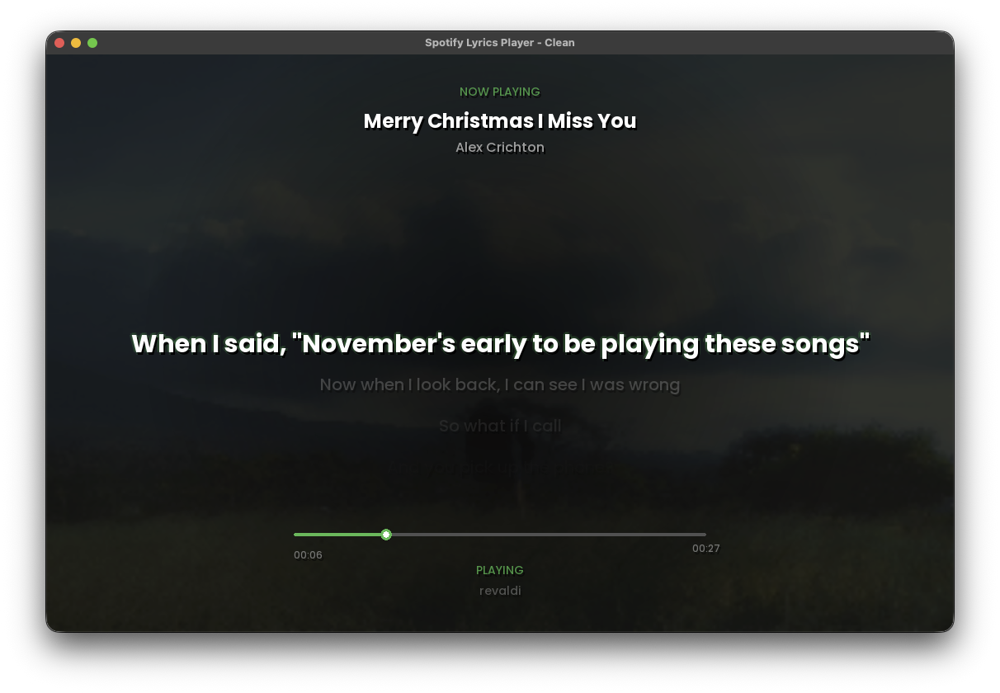

# 🎵 Pygame Music Player - Typography Showcase

Aplikasi pemutar musik berbasis Pygame dengan tampilan User Interface (UI) bernuansa Dark Mode modern. Proyek ini memamerkan penggunaan hirarki tipografi secara estetis menggunakan 4 variasi bobot font Poppins.

## 📸 Preview Tampilan

<p align="center">
  
</p>

## ✨ Fitur Utama

* **Tipografi Terstruktur:** Menerapkan 4 variasi font (Bold, Medium, Regular, Italic) untuk menciptakan hirarki visual yang jelas.
* **Efek Text Shadow:** Rendisi teks dilengkapi bayangan (offset) halus untuk efek timbul dan keterbacaan yang tinggi.
* **Smart Font Fallback:** Sistem deteksi font otomatis—jika file font kustom tidak ditemukan, aplikasi akan berpindah ke font bawaan sistem tanpa memicu crash.
* **UI Responsive & Modern:** Menggunakan palet warna konsisten dengan sudut card border-radius yang lembut.

## 📂 Struktur Proyek

```text
├── assets/
│   └── fonts/
│       ├── Poppins-Bold.ttf
│       ├── Poppins-Medium.ttf
│       ├── Poppins-Regular.ttf
│       └── Poppins-Italic.ttf
├── doc/
│   └── preview.png          # Foto pratinjau tampilan aplikasi
├── main.py                  # Script utama Pygame
└── README.md                # Dokumentasi proyek
```

## 🎨 Penggunaan Font

| Jenis Font | File Asset | Peruntukan UI |
| :--- | :--- | :--- |
| **Bold** | `Poppins-Bold.ttf` | Judul lagu utama (Now Playing) |
| **Medium** | `Poppins-Medium.ttf` | Judul seksi & header playlist |
| **Regular** | `Poppins-Regular.ttf` | Nama lagu pada daftar playlist & durasi |
| **Italic** | `Poppins-Italic.ttf` | Sub-teks nama artis & genre musik |

## 🚀 Cara Menjalankan

### 1. Prasyarat
Pastikan Anda sudah menginstal Python versi 3.8 ke atas di komputer Anda.

### 2. Instalasi Dependensi
Instal pustaka Pygame menggunakan pip:
```bash
pip install pygame
```

### 3. Jalankan Aplikasi
Jalankan file `main.py` melalui terminal atau command prompt:
```bash
python main.py
```

## 📝 Lisensi

Proyek ini berada di bawah lisensi [MIT License](LICENSE). Bebas digunakan dan dikembangkan kembali.
